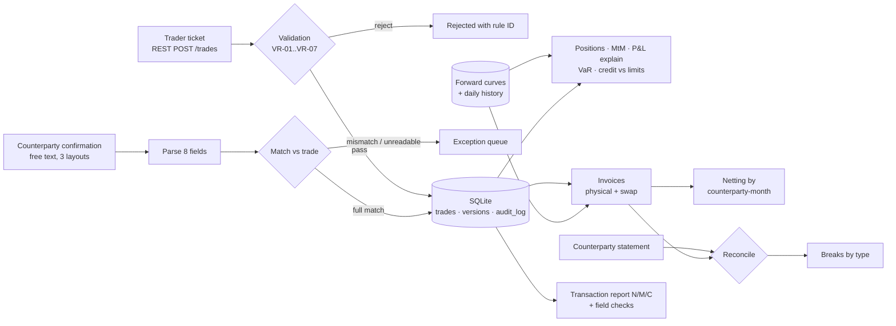

# Data flow

| Step | Module | Input | Output |
|---|---|---|---|
| Capture | `trades.py` | Ticket, reference data, forward curve | Stored trade + audit entry, or rejection with rule ID |
| Confirm | `confirmations.py` | Confirmation text | MATCHED / MISMATCH (fields) / UNREADABLE |
| Value and risk | `risk.py` | Live trades, curves | Positions, MtM, P&L explain, VaR, credit report |
| Settle | `settlement.py` | Delivered months, fixings | Invoice lines, net amounts, receivables |
| Reconcile | `settlement.py` | Our lines, counterparty statement | Matched count, breaks by type |
| Report | `reporting.py` | Audit log + versions | Transaction report CSV, check errors |
